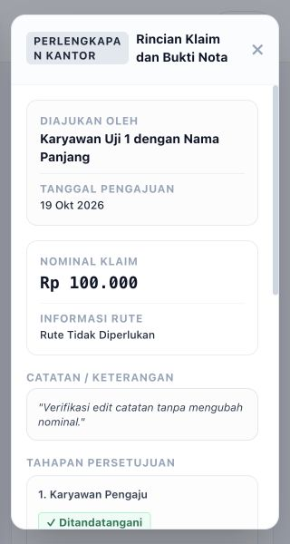

# Hasil optimasi UX, responsivitas, dan performa

Tanggal: 19 Oktober 2026.

## Perubahan

- Navigasi mempertahankan posisi sidebar serta konteks filter, pagination, dan posisi daftar saat kembali dari formulir. Drawer mobile mendukung keyboard dan mengisolasi fokus.
- Modal memiliki batas tinggi layar, fokus terperangkap, Escape, pengembalian fokus, dan animasi yang mengikuti preferensi reduced motion.
- Layout mobile memakai kartu atau tabel dengan area gulir yang jelas. Spasi, label tindakan, ukuran input, target sentuh, dan layout layar lebar diperbaiki.
- Pencarian asinkron membatalkan permintaan lama, menampilkan status memuat, dan menangani sesi kedaluwarsa. Back/Forward menyelaraskan URL dan filter.
- Dashboard menampilkan pekerjaan tertunda sesuai lingkup pengguna. Status klaim dan ekspor menggunakan filter yang sama.
- JavaScript halaman dipisah menjadi entry Vite; pustaka PDF, signature, Alpine collapse, dan ikon tersedia lokal. Pemuatan PDF dibatasi pada halaman terkait.
- Proses persetujuan/dokumen reimbursement dipisahkan ke service. Kalkulasi payroll daftar/ekspor memakai pengambilan data secara batch tanpa mengganti rumus.
- Pencarian laporan dan penghapusan massal diperbaiki, termasuk otorisasi dan validasi seluruh ID sebelum perubahan.
- Input nominal klaim mempertahankan desimal kanonis dan menerima pengelompokan rupiah lama. Sinkronisasi tampilan menggunakan event input agar paste ikut tersimpan.

## Verifikasi

- Backend: 74 tes lulus, 723 assertions.
- Frontend: 11 tes lulus.
- Build produksi, kompilasi Blade, dan git diff --check berhasil.
- Chromium: 37 halaman pada lebar 320, 375, 768, 1024, 1440, 1920, dan 3840 px (259 kombinasi). Tidak ditemukan overflow halaman pada pemeriksaan tersebut; tabel lebar memakai area gulir tersendiri.
- Modal: 10 jenis modal pada tiga lebar (30 kombinasi), ditambah pemeriksaan landscape pendek dan kalender mobile.
- Alur browser: filter, pagination, Back/Forward, kembali dari edit, fokus drawer, pratinjau PDF dua halaman, dan pengaturan posisi/ukuran tanda tangan melalui keyboard.
- Uji simpan klaim sintetis: Rp100.000 tetap sama setelah disimpan dan setelah hanya catatan diedit.

Pengujian browser menggunakan SQLite dan akun sintetis terisolasi melalui tests/Browser/router.php, bukan database operasional. Tidak ada persetujuan klaim atau penghapusan permanen yang dijalankan melalui browser.

## Batas pemeriksaan

Belum diuji pada perangkat fisik, Safari/iOS, atau beban produksi besar. Navigasi utama tetap mengikuti arsitektur Laravel Blade. Build masih memberi peringatan eval dari PDF.js versi lama; opsi evaluasi PDF dinonaktifkan saat runtime. Peningkatan versi utama PDF.js membutuhkan pengujian kompatibilitas terpisah.

Perubahan PKWT yang masuk bersamaan dipertahankan; pengurutan tanggal dibuat kompatibel dengan SQLite dan MySQL. Migrasi PKWT hanya dijalankan pada database QA.

Data ukuran tersimpan di [ux-responsive-2026-10-19.json](ux-responsive-2026-10-19.json). Bukti modal mobile:

